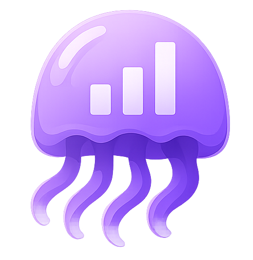

# { .page-brand } Libraries, storage and forecast

The Libraries page gives admins a view of where disk space goes and how fast it is filling.

!!! info "Beta feature"
    Available on the **1.4.2-beta** line. Behaviour may still change before the stable release.

## Disk-fill forecast {#disk-forecast}

**Open:** Libraries (admins only). The forecast is at the top of the page.

- Free and used space comes from the disks reported by Sonarr, Radarr or Lidarr. Connect at least one under Integrations.
- Shows space added per day and roughly how long until the disks are full, with a range based on the last 30 and 90 days.
- Lists the libraries growing fastest.
- Shows **Stable** when little is being added, and asks for more data instead of guessing when history is too short.

## Storage by library {#storage-by-library}

**Open:** Libraries (admins only)

Each library shows its size, share of the total and title count. Open the **top 20 largest** titles to see size, plays and when each was last played.

Soft hints flag titles worth a second look:

| Hint | Meaning |
| --- | --- |
| Never played | No recorded plays |
| Not played in 2+ years | Last play is over two years ago |
| Possible duplicate | A movie shares its name and year with another copy |

Titles added in the last 90 days never get a hint.

!!! tip "Nothing is deleted here"
    Storage by library is read-only. Remove media in Jellyfin, the arr apps or [Maintainerr](../integrations/maintainerr.md).
